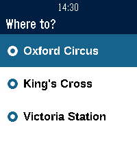
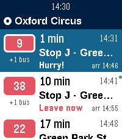
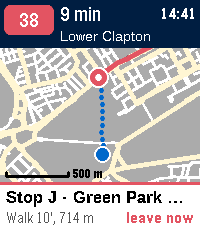
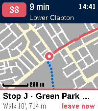

# Next Bus for Pebble Time 2

[](https://github.com/amitn/pebble-bus/actions/workflows/build.yml)
[](LICENSE)

A Pebble watchapp (platform `emery`, 200×228 color) that shows the next buses
from where you are to destinations you choose in the phone settings, plus a
map of the boarding stop.

## Screenshots (London, from Green Park)

| Where to? | Next buses | Stop map | Centered on the stop |
| :---: | :---: | :---: | :---: |
|  |  |  |  |
| Pick one of your saved destinations | Countdown, boarding stop with its letter, and when to leave. The green dot marks a TfL live time | Your position (blue), dotted walk to the stop, and the bus route in its line color | Select switches the center between overview, the stop and you. Up/Down zoom |

- **Departures list**: line badge in the route's color, countdown to the bus,
  boarding stop, when to leave (green/orange/red by urgency) and arrival time.
  Refreshes every 2 minutes; long-press Select to refresh now.
- **Stop map** (Select on a bus): OpenStreetMap streets, a dotted walking path
  from you to the stop, and the bus route. Up/Down zoom; Select cycles the
  center between overview, the stop, and you.
- **London live times**: Transitous only has timetables for London buses, so
  for boarding stops with a TfL code the app pulls TfL's live predictions and
  matches each bus to its prediction (same line, closest to the timetable).
  Live times get a green dot. The stop letter from the stop flag is shown first
  ("Stop J · Green Park Station").
- **Hebrew / RTL**: stop names render right-to-left with a bundled Latin + Hebrew
  font, because Pebble's system fonts have no Hebrew glyphs.
- **Settings page**: up to 5 destinations picked by search (no free-text
  addresses to mis-geocode), a starting point (GPS or a fixed place), buses-only,
  max transfers, max walk.

## Data sources (no API keys)

| What | Source |
| --- | --- |
| Trip planning | [Transitous](https://transitous.org) (MOTIS 2 API, worldwide GTFS + realtime where available) |
| Place search | Transitous geocoder |
| London live arrivals | [TfL Unified API](https://api.tfl.gov.uk) (Powered by TfL Open Data) |
| Street map | [OpenFreeMap](https://openfreemap.org) vector tiles (OpenMapTiles schema) |

Street data is cached on the phone per stop (8 most recent, 30 days), so a
daily commute stop downloads its tiles only once.

**If you fork this**, set `CONTACT` in `src/pkjs/http.js` to your project URL
or e-mail. Transitous' [usage policy](https://transitous.org/api/) requires a
User-Agent with the app name, version and a contact, and asks projects
with many users to check in with them first. The service is for
non-commercial open-source apps. TfL's API works without a key for light
use; register for a free app key at https://api-portal.tfl.gov.uk if you
need a higher rate limit.

## Build & run

Requires the Pebble SDK (`uv tool install pebble-tool`, then `pebble sdk install latest`).
The SDK also needs Node.js.

```sh
pebble build
pebble install --phone <phone-ip>       # real watch, via the Pebble app's developer connection
pebble install --emulator emery         # emulator
pebble emu-app-config --emulator emery  # open the settings page for the emulator
```

Or download the `.pbw` from the latest
[release](https://github.com/amitn/pebble-bus/releases), or from the
artifacts of any [CI run](https://github.com/amitn/pebble-bus/actions).

## CI and releases

[`.github/workflows/build.yml`](.github/workflows/build.yml) builds the app on
every push and pull request and attaches `pebble-bus.pbw` to the run.

To release, bump `version` in `package.json`, commit, then tag and push:

```sh
git tag v1.1.0 && git push origin v1.1.0
```

The tag must match `package.json` or the build fails. A tag build also:

1. creates a GitHub release with `next-bus-v1.1.0.pbw` attached, and
2. publishes to the [Pebble app store](https://apps.repebble.com) with
   `pebble publish`, using the README screenshots. The first run creates the
   store listing.

Step 2 needs a one-time secret. Log in with the Pebble tool, then store its
long-lived Firebase refresh token in the repo (path shown is for Linux):

```sh
pebble login
gh secret set PEBBLE_FIREBASE_REFRESH_TOKEN --repo amitn/pebble-bus --body \
  "$(jq -r .refresh_token ~/.local/share/pebble-sdk/oauth_firebase/firebase_oauth_storage.json)"
```

Without the secret, the store step is skipped with a warning.

## Layout

```
src/c/
  main.c          AppMessage protocol, destination persistence
  dest_window.c   "Where to?" menu (skipped when there's one destination)
  list_window.c   departures list
  map_window.c    stop map renderer (vector polylines from the phone)
  util.c          RTL-aware text fitting, time formatting, line badge
src/pkjs/
  index.js        message handling, location, glue
  transit.js      Transitous /plan → departures
  tfl.js          TfL live predictions for London stops
  mapdata.js      map building: projection, clipping, simplification, packing, cache
  vectortile.js   minimal Mapbox Vector Tile decoder
  text.js         simplified bidi (logical → visual order), UTF-8 safe truncation
  config_page.js  settings page (served as a data: URL)
```

The phone projects map geometry to meters around the stop and sends compact
polylines (`[kind:u8][n:u8][n × (x:i16, y:i16)]`, about 9 KB for a dense city
block) so the watch only scales and draws.

## Contributing

See [CONTRIBUTING.md](CONTRIBUTING.md).

## License

The code is under the [MIT License](LICENSE).

Bundled fonts: Liberation Sans (SIL OFL 1.1), see `resources/fonts/LICENSE-Liberation.txt`.
Map data © OpenStreetMap contributors.
